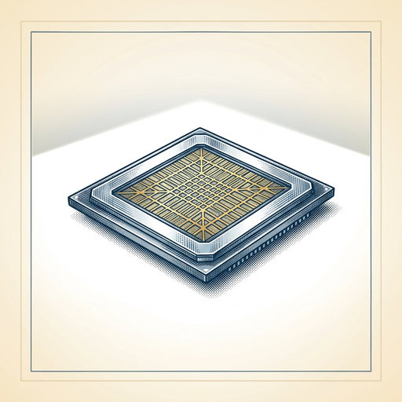

# ai espresso ☕ — Edition 114 · Variant C (Newspaper Comic · Snackable)

*your morning cup of AI*
**SUN · OCT 18 · 2026**

---


**NEWS**

## ChatGPT can now read your Chrome tabs and fill out forms for you

OpenAI's Chrome extension now lets ChatGPT see all your open browser tabs when you tag it. Ask it to compare products across tabs, fill out registration forms, or draft emails based on what you're looking at — without leaving Chrome. The sidebar version can also control tabs to send messages, download files, and organize your workspace.

*AI assistants are moving from chat windows into your actual workflow, handling multi-tab research and data entry.*

[The Verge — AI](https://www.theverge.com/ai-artificial-intelligence/1012510/openai-chatgpt-google-chrome-tabs) · Oct 18

---


**NEWS**

## Amazon just turned Bee into a wearable AI that remembers your conversations

Amazon launched Bee Frontier (a wristband) and Bee Eclipse (a magnetic phone attachment) that listen to your conversations, pull out key details, and turn them into summaries, to-dos, and reminders. Both connect to Alexa+ for hands-free access and to Amazon.com for personalized shopping suggestions based on what you've talked about.

*Amazon is betting you'll wear an always-on AI that captures ambient conversations to compete with Meta's smart glasses.*

[Amazon News (About Amazon)](https://www.aboutamazon.com/news/devices/amazon-personal-ai-bee-frontier-bee-eclipse?utm_source=rss) · Oct 18

---



**NEWS**

## Google just cut quantum computing's biggest bottleneck by 40x

Google showed that 'magic state cultivation' works on real quantum hardware, reducing errors 40x. Magic states enable useful quantum programs, but making them error-free normally eats up 95% of a quantum computer's power. The new technique filters out bad attempts while creating the states, leaving far more room for actual computing.

*Quantum computers can now spend their resources on solving problems instead of fixing themselves.*

[Google — Innovation & AI](https://blog.google/innovation-and-ai/models-and-research/quantum-computing/magic-state-cultivation-quantum-computing/) · Oct 18

---


**NEWS**

## Mistral just shipped a tiny time-series model that beats bigger forecasters

Timestral, Mistral's first time-series foundation model, tops three major benchmarks at just 209M parameters—two-thirds smaller than previous leaders. It handles multivariate forecasts and runs on CPUs, meaning companies can now forecast sensor data, supply chains, or cash flows without massive compute or training from scratch every time.

*Enterprise forecasting just got cheaper and faster without sacrificing accuracy.*

[Mistral News](https://mistral.ai/news/timestral) · Oct 18

---


**NEWS**

## Cursor's cloud agents can now build shareable interactive canvases

Cursor shipped three upgrades to its cloud coding agents: they can now create interactive canvases you can share with your team via link, there's a new API to spin up and manage cloud environments programmatically, and environments now handle up to 300 repos while loading five times faster.

*Coding agents just became collaborative tools, not just solo dev assistants.*

[Cursor Changelog (official)](https://cursor.com/changelog/cloud-agent-canvases-and-environments) · Oct 18

---


**NEWS**

## NVIDIA ships open models that run AI agents on laptops and servers

NVIDIA released three open-weight models designed for always-on agents. Super VL runs multimodal workflows at 5x the speed of competitors in its class. Bolt 74B fits in 24GB of RAM and runs locally on RTX laptops. Bolt E4B runs conversational agents in just 4GB. All three are free to download, fine-tune, and deploy on your own hardware.

*You can now run production AI agents entirely on infrastructure you control.*

[NVIDIA Blog](https://blogs.nvidia.com/blog/nemotron-3-5-super-vl/) · Oct 18

---


---


**☕ Try this prompt**

### The skill investment audit

*When your learning list is long but your time isn't infinite.*


```
I'll describe what I currently do at work and what I want to be doing in two years. Tell me: the one skill I should double down on, the one I'm overinvesting in, and the uncomfortable learning project I should start this month that nobody will appreciate until later.
```

---

*brewed by ai espresso · [spot something off?](mailto:jhimel@solvd.com?subject=AI%20Espresso%20issue%20report) · [repo](https://github.com/jackiehimel/AI-espresso-agent)*
