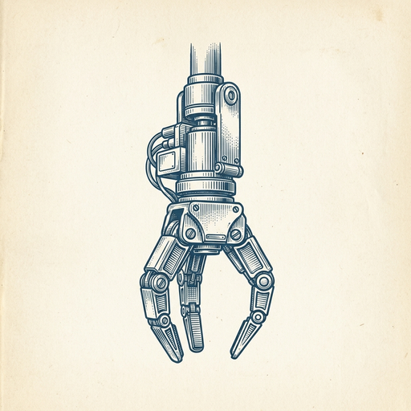
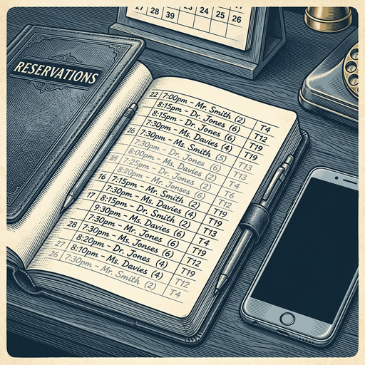
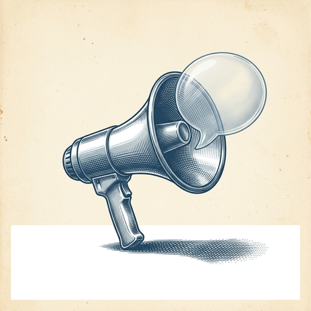
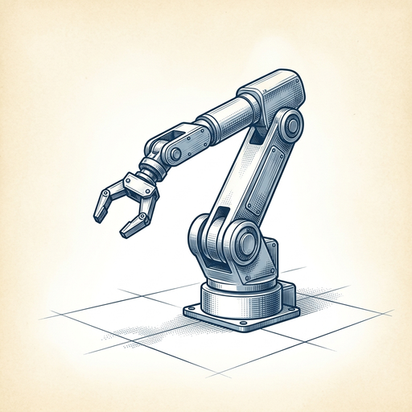

# ai espresso ☕ — Edition 116 · Variant C (Newspaper Comic · Snackable)

*your morning cup of AI*
**TUE · OCT 20 · 2026**

---



**NEWS**

## This robot picks things up faster than a human—and investors just bet $1.45B on it

Eka Robotics built a gripper and AI model that picks up 1,500 objects per hour (humans do ~600) with 95%+ reliability. The robot moves so fast it could hurt itself, which means the AI is confident enough to work at dangerous speeds. Veteran roboticists call it a 'wow factor' breakthrough—one compared the emotional impact to when robots first learned to walk reliably.

*Picking things up has been robotics' hardest problem; this is the first system that looks like it actually solved it.*

[TechCrunch — AI](https://techcrunch.com/2026/10/20/eka-is-worth-1-45-billion-thanks-to-a-physical-ai-model-that-has-experts-raving/) · Oct 20

---


**NEWS**

## Perplexity's agent can now run entirely on your Mac, no internet needed

Perplexity Pro subscribers can now run the Computer agent fully offline on Apple silicon Macs. The local mode handles planning, reasoning, and file tasks on-device—reading messages and emails, finding deadlines, creating notes—without sending data to the cloud unless you explicitly approve it.

*Privacy-focused AI that works when you're offline, on a plane, or just don't want your files leaving your laptop.*

[9to5Mac — AI](https://9to5mac.com/2026/10/20/perplexitys-computer-can-now-run-entirely-on-your-mac-even-offline/) · Oct 20

---



**NEWS**

## Yelp's AI can now call restaurants to check wait times for you

Yelp's new Check for Me feature lets you enter your party size, then sends an AI agent to call the restaurant and text you back with the current wait time. The app is also getting OpenTable integration for booking and can now remember your preferences across chats.

*Agent-to-agent calls are becoming normal—your AI talking to a restaurant's AI to save you a phone call.*

[TechCrunch — AI](https://techcrunch.com/2026/10/20/yelp-can-now-call-on-your-behalf-to-check-wait-times-at-a-restaurant/) · Oct 20

---



**NEWS**

## Salesforce buys AI marketing platform Braze for $5.7 billion

Salesforce is acquiring Braze, a platform that uses AI to help marketers personalize campaigns and automate customer messaging. The deal gives Salesforce deeper tools for targeting customers across email, push notifications, and in-app messages — all powered by predictive AI that decides when and what to send.

*Salesforce is betting billions that AI-driven marketing automation is the next must-have for enterprise sales teams.*

[Bloomberg Technology](https://www.bloomberg.com/news/articles/2026-10-20/salesforce-to-buy-marketing-platform-braze-for-5-7-billion) · Oct 20

---



**NEWS**

## Ex-OpenAI research chief built a $1.5B startup making AI for factory floors

Bob McGrew's Arda raised $230 million to build AI assistants that help manufacturing engineers design and reconfigure assembly lines in days instead of months. The software is already running at defense contractor Anduril. McGrew says it does for factory engineers what Claude or Cursor does for programmers.

*AI coding assistants are now jumping from software development to physical production lines.*

[CNBC — Technology](https://www.cnbc.com/2026/10/20/ex-openai-executive-builds-1point5-billion-ai-manufacturing-startup-arda.html) · Oct 20

---


---


**☕ Try this prompt**

### The priority knife fight

*When everything is urgent and you need to disappoint someone on purpose.*


```
I have way too much on my plate. Below I'll list everything I'm supposed to deliver this month. Force-rank them by real impact, then tell me which two I should visibly de-prioritize, what I'll lose by doing that, and the exact sentence I use to explain it to my team or manager.
```

---

*brewed by ai espresso · [spot something off?](mailto:jhimel@solvd.com?subject=AI%20Espresso%20issue%20report) · [repo](https://github.com/jackiehimel/AI-espresso-agent)*
