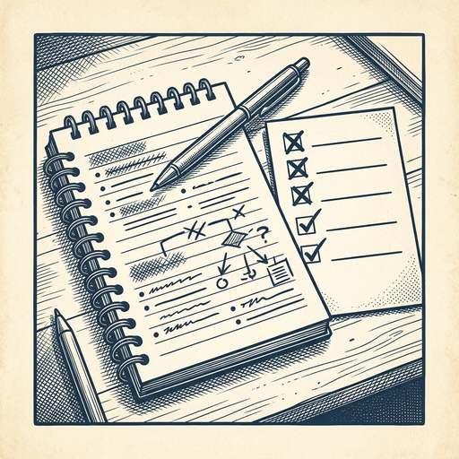

# ai espresso ☕ — Edition 121 · Variant C (Newspaper Comic · Snackable)

*your morning cup of AI*
**SUN · OCT 25 · 2026**

---


**NEWS**

## NVIDIA's new Minerva platform spots GPU problems before they tank your training run

Minerva connects telemetry from GPUs, networks, and storage into a live knowledge graph that can trace a slow training job to a single degraded component—even in clusters with hundreds of thousands of GPUs. It uses ML to detect anomalies, predict failures, and group event storms into root causes instead of flooding operators with alerts.

*One bad GPU can slow an entire cluster; this finds it before you lose days of compute.*

[NVIDIA Blog](https://blogs.nvidia.com/blog/minerva-platform-infrastructure/) · Oct 25

---


**NEWS**

## Cerebras fits a 3-trillion-parameter model across 57 wafer chips

Cerebras published the architecture behind running Kimi K3—a 3T-parameter open model that rivals GPT-5.6 on coding benchmarks—at 1,000+ tokens per second. They split dense attention layers (one per 44 GB wafer) from linear layers (two per wafer), using 4-bit weights and an 8-bit KV cache to keep everything on-chip across 57 wafers.

*Shows how multi-wafer clusters let you serve frontier models without off-chip memory bottlenecks.*

[Hacker News (front page)](https://www.cerebras.ai/blog/how-we-deploy-trillion-parameter-frontier-models-on-cerebras) · Oct 25

---


**NEWS**

## Hugging Face's DNA model lets you ask plain-English questions about genes

The new Carbon-X model runs on a laptop and answers conversational questions about how DNA changes affect gene activity and health. It's trained on both genomic sequences and natural language, so researchers (and potentially patients) can ask 'what does this mutation do?' instead of reading numeric predictions.

*Makes genomic research accessible to non-geneticists who can now query DNA like they'd query ChatGPT.*

[Wired — AI](https://www.wired.com/story/hugging-face-new-ai-biology-model-chat-with-dna/) · Oct 25

---


**NEWS**

## Block made an AI that learned to talk by listening, not reading

Jack Dorsey's Block released Dessa, a voice AI trained only on human speech—no text. It runs locally on a MacBook Pro and holds surprisingly natural conversations, though it sometimes mistakes who it's talking to or goes on unexpected tangents about Superman movies. The demos show it playing guessing games and even getting 'teary' about a surprise Paris trip.

*Training AI on speech instead of text could make voice assistants feel more human.*

[The Verge — AI](https://www.theverge.com/ai-artificial-intelligence/1017906/jack-dorsey-block-dessa-ai-voice-speech) · Oct 25

---


**NEWS**

## OpenAI fired three safety researchers over Signal chats about transparency

The researchers were pushing to keep AI system internals visible to outsiders, but OpenAI terminated them for mishandling sensitive information in private messages. The firings highlight growing tension between safety teams advocating for external scrutiny and companies tightening control over what gets shared about their models.

*The clash shows how far AI labs will go to protect internal details, even from their own safety advocates.*

[WSJ — Tech](https://www.wsj.com/tech/ai/the-signal-chats-that-cost-openai-researchers-their-jobs-594c5853?mod=rss_Technology) · Oct 25

---


---



**☕ Try this prompt**

### The decision shadow

*When you need to learn from a choice instead of just regretting it.*


```
I made a decision recently that I'm second-guessing. I'll describe what I chose and why. Don't tell me if it was right or wrong. Instead, tell me what this decision reveals about my actual priorities versus my stated priorities, and which future decisions just got easier or harder because of it.
```

---

*brewed by ai espresso · [spot something off?](mailto:jhimel@solvd.com?subject=AI%20Espresso%20issue%20report) · [repo](https://github.com/jackiehimel/AI-espresso-agent)*
