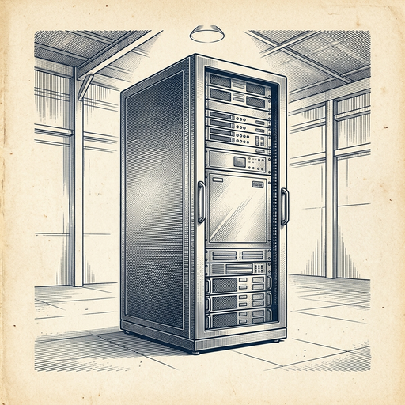
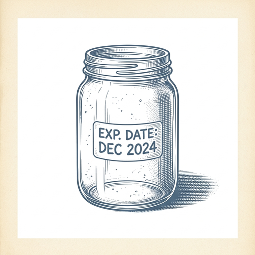

# ai espresso ☕ — Edition 122 · Variant C (Newspaper Comic · Snackable)

*your morning cup of AI*
**MON · OCT 26 · 2026**

---


**NEWS**

## Anthropic just filed to go public

The maker of Claude filed its S-1 with the SEC today, setting up an IPO on Nasdaq under ticker 'ANT.' No share count or price range yet — this is the formal start of the process that lets underwriters (Goldman, Morgan Stanley) begin gauging investor appetite.

*First major AI lab to tap public markets since the ChatGPT wave began.*

[Anthropic News](https://www.anthropic.com/news/s1-sec) · Oct 26

---


**NEWS**

## SpaceX just locked in $40B to lease GPUs instead of buying them

Apollo Global will buy Nvidia's next-gen chips and lease them to SpaceX over five years, starting in early 2027. SpaceX says it's seeing under one-year payback on AI infrastructure as its Grok chatbot and cloud business now pull in more revenue than Starlink and rockets combined—$7.6B of $14.6B total last quarter.

*The biggest AI companies are now financing compute like airlines lease planes—capital-light, fast to scale.*

[TechCrunch — AI](https://techcrunch.com/2026/10/26/spacex-locks-in-40b-gpu-financing-deal-with-apollo/) · Oct 26

---



**NEWS**

## Meta plans to raise $95 billion to build more AI infrastructure

The Facebook parent announced it will raise up to $95 billion through stock offerings and debt to fund data centers, chips, and what it calls 'personal superintelligence.' It's one of the largest corporate fundraising plans in tech history, signaling Meta expects its AI spending to keep climbing beyond the $65 billion it already committed for 2025.

*Meta is betting nearly $100 billion that AI infrastructure will define the next decade of competition*

[WSJ — Tech](https://www.wsj.com/tech/ai/meta-plans-35-billion-stock-offering-to-power-ai-buildout-eyes-95-billion-total-plan-10b8947e?mod=rss_Technology) · Oct 26

---


**NEWS**

## OpenAI built Fanatics a 'complete the outfit' feature in 24 hours

Fanatics launched Shop the Look across NFL, NBA, MLB, and NHL stores—an AI system that suggests matching gear when you're buying a jersey. OpenAI's Codex helped engineers build and test the first 50 product recommendations in under a day, then scale to 30,000 items.

*AI just collapsed weeks of e-commerce dev work into a single day.*

[OpenAI News](https://openai.com/index/fanatics-streamline-fan-experience) · Oct 26

---


---



**☕ Try this prompt**

### The skill expiration label

*When you suspect your expertise has a shelf life but aren't sure what to do about it.*


```
I'll describe a skill I currently rely on. Tell me: what external force will make it worth half as much in three years, what adjacent skill I should be building now, and one way to hedge so I'm valuable either way.
```

---

*brewed by ai espresso · [spot something off?](mailto:jhimel@solvd.com?subject=AI%20Espresso%20issue%20report) · [repo](https://github.com/jackiehimel/AI-espresso-agent)*
