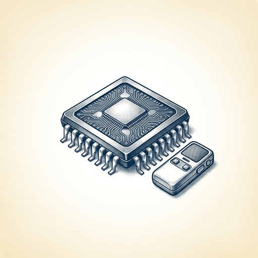
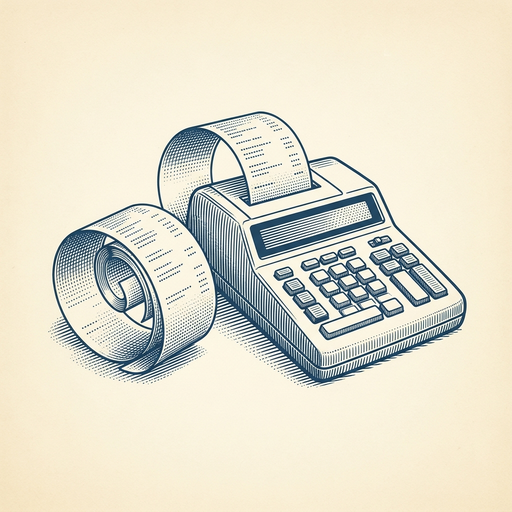

# ai espresso ☕ — Edition 124 · Variant C (Newspaper Comic · Snackable)

*your morning cup of AI*
**WED · OCT 28 · 2026**

---


**NEWS**

## Google just shipped Gemini 4 Carbon, built to find and patch security holes

DeepMind's new frontier model ranks #1 on the latest AI benchmark and leads on cybersecurity tasks — finding vulnerabilities at 88% accuracy, exploiting them at 55%, and patching code at 71%. It's designed for multi-day agent runs on complex engineering problems. Rolling out first to cyber defenders, then developers at $2 per million input tokens.

*Google's newest model is explicitly optimized for the security work companies actually need agents to do.*

[Google DeepMind Blog](https://deepmind.google/blog/gemini-4-carbon-our-next-frontier-model/) · Oct 28

---


**NEWS**

## Anthropic is now running its own drug discovery programs

Anthropic's life sciences team partnered with six biotech companies and launched internal drug programs—including treatments for rare childhood muscular dystrophy—where Claude handles scientific and operational work. The goal is to speed up every stage of drug development, from target identification to clinical trial design, not just molecule generation.

*AI labs are moving from tool-makers to participants in the drug development pipeline itself*

[Anthropic News](https://www.anthropic.com/research/early-progress-drug-development) · Oct 28

---


**NEWS**

## Amazon's new Alexa Home Map shows your whole house in 3D

You can now see and control every connected device in your home from a single interactive 3D map. Walk through your house with an iPhone to scan rooms, then place your Echo devices, Ring cameras, lights, and thermostats exactly where they sit. The map updates in real time, showing which lights are on and who's moving around your yard.

*No more guessing which Alexa command controls which room—just tap the map.*

[Amazon News (About Amazon)](https://www.aboutamazon.com/news/devices/alexa-home-map-3d-smart-home-view?utm_source=rss) · Oct 28

---



**NEWS**

## Nvidia just shipped a free transcription model that runs on a single chip

Nemotron 3.5 Transcribe handles 40 languages, tells eight speakers apart, and processes hour-long recordings — all while running on hardware from a robotics controller to a datacenter GPU. It's designed for recorded audio (not livestreams) and targets meeting transcription and medical documentation apps.

*Free, on-device transcription means developers can build voice apps without cloud API costs or privacy concerns.*

[TechCrunch — AI](https://techcrunch.com/2026/10/28/voice-ai-in-vogue-nvidia-releases-new-open-transcription-model/) · Oct 28

---


**NEWS**

## Chrome can now pull flight numbers and tracking codes from your Gmail to fill forms

Google's updating Chrome's autofill to scan your Gmail for things like confirmation numbers, membership IDs, and addresses when you're filling out web forms. It's opt-in, ties into Gemini's existing Google Apps integration, and works on desktop and mobile. Think Apple's auto-fill verification codes, but for any form field Chrome thinks it can help with.

*Another reason to stay locked into Google's ecosystem — and let AI read your email.*

[TechCrunch — AI](https://techcrunch.com/2026/10/28/chromes-ai-powered-autofill-can-now-dig-through-your-gmail-to-fill-out-forms/) · Oct 28

---


---



**☕ Try this prompt**

### The energy audit

*When you're busy all the time but can't remember the last thing you actually finished.*


```
Look at my calendar for the past two weeks. I'll paste it below. Tell me which three recurring activities are stealing the most energy relative to their actual impact. Then rank my week by which days I'm set up to do my best thinking versus which days I'm just context-switching into oblivion.
```

---

*brewed by ai espresso · [spot something off?](mailto:jhimel@solvd.com?subject=AI%20Espresso%20issue%20report) · [repo](https://github.com/jackiehimel/AI-espresso-agent)*
