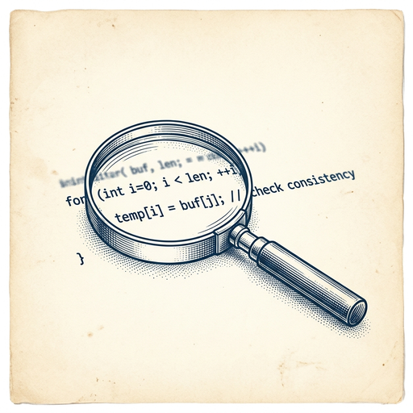

# ai espresso ☕ — Edition 125 · Variant C (Newspaper Comic · Snackable)

*your morning cup of AI*
**THU · OCT 29 · 2026**

---



**NEWS**

## Google's Gemini 4 Carbon can hunt bugs and run engineering tasks for days

Google just released Gemini 4 Carbon, a new frontier model that tops benchmarks for finding security vulnerabilities and generating secure code. It beat Claude Opus 5.5 and GPT-6 Astra on several tests, and Google says internal teams have watched it run for days straight on complex multi-step engineering work without shortcuts or getting derailed by prompt injection.

*A model that can autonomously debug and secure code for days changes what engineers can delegate.*

[The Verge — AI](https://www.theverge.com/tech/1021339/google-gemini-4-carbon-cybersecurity-frontier) · Oct 29

---


**NEWS**

## Mistral just open-sourced a 1-trillion-parameter coding and security model

Mistral Large 4 (nicknamed Le Chonk) is now fully open-weight after three weeks of additional training pushed it to the top of coding benchmarks. The trillion-parameter model leads open models in coding and cybersecurity tasks, offers three reasoning modes to balance cost and performance, and runs entirely on European infrastructure for organizations that need data sovereignty.

*A frontier model you can download, customize, and run yourself just became the best open option for code.*

[Mistral News](https://mistral.ai/news/mistral-large-4-oss) · Oct 29

---


**NEWS**

## DoorDash is buying Instacart for $17 billion

The deal combines America's largest restaurant delivery app with its biggest grocery delivery platform. DoorDash gets Instacart's 600,000 shoppers and relationships with every major supermarket chain, while Instacart users get access to restaurant delivery in a single app.

*One company will now control most of what Americans order to their door.*

[NYT — Technology](https://www.nytimes.com/2026/10/29/technology/doordash-instacart-acquisition-delivery.html) · Oct 29

---


**NEWS**

## Wabi now builds mini apps on the fly as your AI assistant

Wabi, founded by Replika's Eugenia Kuyda, just raised $55M at a $1.25B valuation after pivoting from a prompt-to-app builder into an AI messenger that generates custom interfaces on demand. Think meal planners, restaurant trackers, or trivia games built in chat as you need them.

*Another bet that the future of AI isn't a text box — it's apps that write themselves.*

[TechCrunch — AI](https://techcrunch.com/2026/10/29/wabi-the-ai-agent-that-builds-mini-apps-now-valued-at-1-25b-after-latest-round/) · Oct 29

---


**NEWS**

## AI is finding so many bugs that engineers can't fix them fast enough

AI tools are now discovering security flaws faster than development teams can patch them, creating a new bottleneck in software security. Engineers across Silicon Valley are racing to prioritize and fix vulnerabilities before hackers can exploit them.

*The bug-finding bottleneck has shifted from discovery to remediation.*

[NYT — Technology](https://www.nytimes.com/2026/10/28/technology/silicon-valley-bugs-ai.html) · Oct 29

---


---


**☕ Try this prompt**

### The negotiation floor

*Before you counter-offer on salary, contracts, or splitting equity.*


```
I'm about to negotiate something I'll describe below. Don't give me tactics or scripts. Instead: tell me the worst deal I could accept and still walk away feeling fine in six months, then tell me the one thing I'm probably overvaluing that the other side doesn't care about at all.
```

---

*brewed by ai espresso · [spot something off?](mailto:jhimel@solvd.com?subject=AI%20Espresso%20issue%20report) · [repo](https://github.com/jackiehimel/AI-espresso-agent)*
