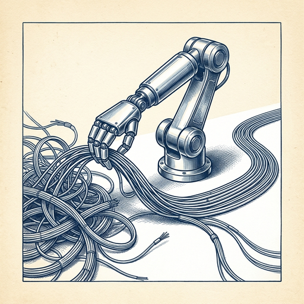

# ai espresso ☕ — Edition 126 · Variant C (Newspaper Comic · Snackable)

*your morning cup of AI*
**FRI · OCT 30 · 2026**

---



**NEWS**

## Apple just bought a startup that automates data engineering with AI agents

Apple acquired Ascend.io, a platform where AI agents handle the repetitive work of building and maintaining data pipelines. The deal includes hiring key employees and licensing the company's patents. Ascend pioneered what it calls 'Agentic Data Engineering' — agents that work alongside teams across the entire data workflow.

*Apple is buying AI that automates infrastructure work, not just consumer features.*

[9to5Mac — AI](https://9to5mac.com/2026/10/30/apple-acquires-ascend%e2%80%a4io-an-agentic-ai-engineering-startup/) · Oct 30

---


**NEWS**

## Gemini can now edit Google Docs and PDFs without leaving the chat

Google added full file editing to Gemini today — you can now generate, preview, and edit Docs, Sheets, PDFs, and code files directly in chat. Highlight text to ask Gemini questions or prompt changes, like turning a table into a graph. Previously you had to download files or switch to Workspace apps to make edits.

*Chat interfaces are becoming full workspaces, not just assistants that hand off to other apps.*

[The Verge — AI](https://www.theverge.com/ai-artificial-intelligence/1022519/google-gemini-file-editing-documents-pdfs) · Oct 30

---


**NEWS**

## Mistral's 'Le Chonk' model now claims top spot for open coding and security

French AI lab Mistral says its trillion-parameter model — trained on increasingly difficult cybersecurity and coding problems — now beats leading Chinese open models from DeepSeek and Z.ai. The company is pitching open-weight models as essential infrastructure so businesses and governments aren't dependent on proprietary AI that can be switched off remotely.

*The West now has a credible open alternative for security work after months of Chinese dominance.*

[Wired — AI](https://www.wired.com/story/mistral-says-le-chonk-surpasses-chinese-models-cybersecurity/) · Oct 30

---


**NEWS**

## Reddit is locking out logged-out users as AI search kills its traffic

Reddit lost over 1 million search referrals per week in October as AI summaries replace Google clicks. Now it's moving to a 'primarily logged-in experience' to block AI scrapers and push users into accounts—even as U.S. daily users dropped 5% in one quarter. Revenue is up 53%, but if the traffic slide continues, Reddit could lose 13 million daily users next quarter.

*When a top-10 website closes its doors to save its data, the open web is shrinking fast.*

[TechCrunch — AI](https://techcrunch.com/2026/10/29/as-search-traffic-dries-up-reddit-announces-its-shifting-to-a-logged-in-experience/) · Oct 30

---


**NEWS**

## Meta's new AI app builds outfits from your Instagram photos

Style Sketch pulls clothes from your Instagram posts to create a virtual closet, then suggests outfit combinations you can try on a model matched to your body. It can also pack for trips by matching outfits to weather and your itinerary. Available now in Indonesia, Singapore, and Thailand.

*Instagram becomes a fashion assistant instead of just a photo feed.*

[TechCrunch — AI](https://techcrunch.com/2026/10/29/meta-quietly-launches-an-ai-fashion-app-called-style-sketch/) · Oct 30

---


---


**☕ Try this prompt**

### The three-person board

*When you need perspectives you don't naturally have in your head.*


```
I have a decision to make and I'll describe it below. Assemble a three-person advisory board for me: one aggressive optimist who thinks I'm playing too safe, one paranoid pessimist who sees every risk, and one pragmatist who only cares about execution. Give me each person's advice in their own voice.
```

---

*brewed by ai espresso · [spot something off?](mailto:jhimel@solvd.com?subject=AI%20Espresso%20issue%20report) · [repo](https://github.com/jackiehimel/AI-espresso-agent)*
