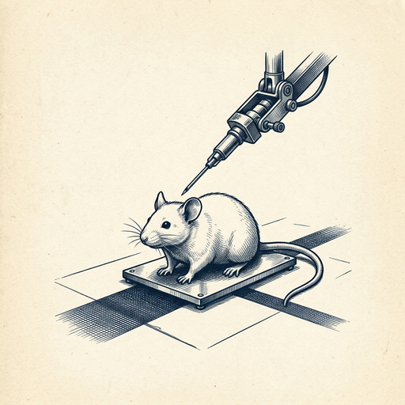

# ai espresso ☕ — Edition 128 · Variant C (Newspaper Comic · Snackable)

*your morning cup of AI*
**SUN · NOV 1 · 2026**

---


**NEWS**

## Google just got a haiku back from an AI chip in orbit

Google's Project Suncatcher satellite responded to its first prompt from space this week — a Gemma model running on a TPU in orbit generated a haiku about being in space. Next up: stress tests to see how the chips handle radiation and thermal extremes, then twin interconnected satellites in 2027.

*Running AI compute in space could eventually handle workloads without ground infrastructure limits.*

[Google — Innovation & AI](https://blog.google/innovation-and-ai/models-and-research/google-research/project-suncatcher-satellite-response/) · Nov 1

---


**NEWS**

## Apple Intelligence is launching in China — with Alibaba's chatbot instead of Siri

Apple's AI features are coming to China in an iOS 27.3 beta next week, but not the new Siri. Instead, Chinese users get notification summaries, translation, rewriting tools, and visual intelligence — plus integration with Alibaba's Qwen chatbot where ChatGPT appears elsewhere. Apple trained a separate LLM specifically for the Chinese market.

*Apple is shipping different AI backends in different countries to navigate regulatory barriers.*

[The Verge — AI](https://www.theverge.com/tech/1023974/apple-intelligence-china-ios-27-3) · Nov 1

---


**NEWS**

## DeepSeek drops a coding agent that runs more on its own

DeepSeek released a prototype coding agent designed to work more autonomously than earlier versions, positioning it as an alternative to Anthropic's Claude Code. The tool aims to handle coding tasks with less hand-holding from developers.

*Another low-cost Chinese AI lab is pushing into agentic coding tools that actually ship.*

[Bloomberg Technology](https://www.bloomberg.com/news/articles/2026-11-01/deepseek-drops-enhanced-coding-agent-with-aim-to-rival-anthropic) · Nov 1

---



**NEWS**

## An AI agent just did brain surgery on a live mouse

A biotech startup connected Claude to a robotic surgical rig and had it perform a gene therapy injection into a mouse's brain—choosing the treatment, coordinates, and controlling the needle itself. The goal: train AI on what actually happens in labs, not just published papers that skip the failures and real-time decisions.

*AI moving from analyzing experiments to running them changes what counts as research data.*

[Wired — AI](https://www.wired.com/story/an-ai-agent-did-brain-surgery-on-live-mouse/) · Nov 1

---


**NEWS**

## OpenAI cuts funding target from $30B to $20B, closes just $11B so far

OpenAI's latest round isn't going as planned. The company originally aimed for $30 billion at a $1.4 trillion valuation, then dropped to $1.25 trillion, and now has lowered its target to $20 billion with only $11 billion secured. UAE investors are leading the round, and the WSJ says some big investors gave a 'tepid' response.

*Even OpenAI is finding it harder to raise money as investors cool on AI infrastructure spending.*

[TechCrunch — AI](https://techcrunch.com/2026/10/31/openai-reportedly-lowers-funding-target-for-new-round/) · Nov 1

---


---


**☕ Try this prompt**

### The meeting receipt

*Right after the call ends, while everyone's calendar is still open.*


```
I just finished a meeting. I'll describe what we discussed below. Give me: the one decision we actually made, the one decision we thought we made but didn't, and the single question that—if answered next—would prevent a follow-up meeting.
```

---

*brewed by ai espresso · [spot something off?](mailto:jhimel@solvd.com?subject=AI%20Espresso%20issue%20report) · [repo](https://github.com/jackiehimel/AI-espresso-agent)*
