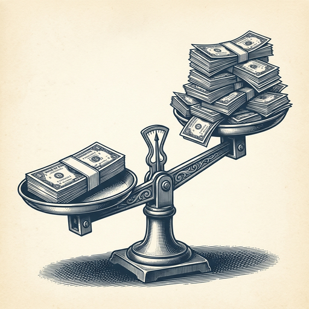
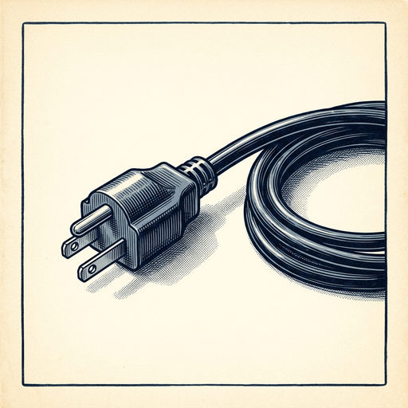

# ai espresso ☕ — Edition 129 · Variant C (Newspaper Comic · Snackable)

*your morning cup of AI*
**MON · NOV 2 · 2026**

---



**NEWS**

## Anthropic hit $17B in quarterly revenue, lost $23B

The AI company reported $17 billion in revenue for the quarter — 12 times higher than last year — but lost $23 billion in the same period. The numbers come as Anthropic prepares for a public offering.

*Hypergrowth AI companies are burning cash faster than they're making it, even at scale.*

[NYT — Technology](https://www.nytimes.com/2026/11/02/business/anthropic-earnings-ai.html) · Nov 2

---


**NEWS**

## Two chip giants are merging for $115B to bet on optical networking for AI data centers

Marvell and Lumentum are combining in a massive wager that optical networking—moving data with light instead of electrical signals—will become essential infrastructure as AI data centers scale. The deal reflects how chip companies see physics, not just software, as the next bottleneck.

*The merger signals that moving data fast enough for AI is now a hardware arms race worth nine figures.*

[NYT — Technology](https://www.nytimes.com/2026/11/02/technology/marvell-lumentum-115-billion-merger-ai.html) · Nov 2

---


**NEWS**

## Israeli startup raises $62.5M to predict what traders will do next

42AI built a model that watches how people interact with support calls, KYC forms, and market moves to forecast their next trading decision. It's running at financial brokerages now, claiming it can predict behavior in new situations by measuring underlying psychological tendencies rather than just pattern-matching past actions.

*If it works, traders and brokers get a crystal ball for human irrationality under pressure.*

[TechCrunch — AI](https://techcrunch.com/2026/11/02/42ai-comes-out-of-stealth-with-62-5m-and-a-world-model-that-can-predict-human-behavior/) · Nov 2

---


**NEWS**

## The New York Times sues Brave browser for scraping paywalled news into AI training data

The Times and several other publishers accuse Brave of selling scraped content—including paywalled articles—to Anthropic, Perplexity, Mistral, xAI, and Cohere for training and queries. Brave also lets users bypass paywalls with a built-in feature, all without publisher consent or payment.

*A browser's own index is now a legal flashpoint for how AI companies source training data.*

[The Verge — AI](https://www.theverge.com/tech/1024588/brave-lawsuit-ai-scraping-new-york-times) · Nov 2

---



**NEWS**

## OpenAI will shut down compute when the power grid gets stressed

OpenAI's launching Grid Protectors, a program where its future data centers will cut power usage during peak demand—cold snaps, heat waves, grid emergencies. They'll work with utilities to decide how much demand they can drop, how fast, and for how long. The idea: use electricity when it's abundant, go dark when families need it most.

*First major AI lab committing to pause training runs when the grid can't handle it.*

[OpenAI News](https://openai.com/index/grid-protectors-program) · Nov 2

---


---


**☕ Try this prompt**

### The competitor's playbook

*When you've been dismissing a rival instead of learning from them.*


```
I'll describe a competitor or alternative approach below. Don't tell me how we're different — I already know that. Instead, steal their three best moves: what are they doing that we should copy outright, what's their smartest trade-off, and what will they regret in two years that we can exploit now.
```

---

*brewed by ai espresso · [spot something off?](mailto:jhimel@solvd.com?subject=AI%20Espresso%20issue%20report) · [repo](https://github.com/jackiehimel/AI-espresso-agent)*
