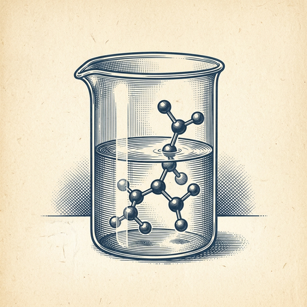
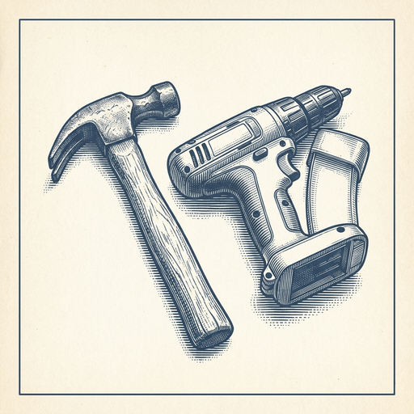

# ai espresso ☕ — Edition 130 · Variant C (Newspaper Comic · Snackable)

*your morning cup of AI*
**TUE · NOV 3 · 2026**

---


**NEWS**

## Google just made AI in schools mandatory by killing Search for holdouts

Schools that disable Gemini features in Google Classroom will now see Search completely turned off for student accounts. Google says "Search and AI are deeply integrated," so administrators can't opt out of AI without losing Search access entirely. The move affects tools used by 150 million students and teachers globally.

*Opting out of AI now means opting out of basic internet access in schools using Google.*

[The Verge — AI](https://www.theverge.com/tech/1025411/google-turn-off-search-ai-features) · Nov 3

---


**NEWS**

## Anthropic says it's 'very close' to AI that improves itself

In its S-1 filing, Anthropic warned it's approaching recursive self-improvement — the point where AI gets good enough at training itself to trigger a dramatic acceleration in capabilities. The company says it's already used AI to build new models whose capability jumps it didn't fully recognize at the time, and may soon meet its own definition of RSI.

*If AI can reliably improve itself, development speed could outpace safety measures*

[TechCrunch — AI](https://techcrunch.com/2026/11/02/anthropic-warns-that-its-very-close-to-rsi-capability-aka-self-building-ai/) · Nov 3

---


**NEWS**

## Apple Watch can now rewind the last 15 seconds of any conversation

Apple's new Audio Intelligence features let Series 12 owners double-press the crown to see a text snippet of what someone just said—like directions or a restaurant special—then save or discard it. Also includes sound alerts for the deaf and Shazam integration. Rolling out in beta with iOS 27.3.

*Your watch becomes a safety net for missed words without recording everything.*

[TechCrunch — AI](https://techcrunch.com/2026/11/02/apple-watchs-ai-features-for-rewinding-and-recapping-conversations-begin-beta-testing/) · Nov 3

---



**NEWS**

## Google built an AI agent that designs new drugs in an hour

DeepMind's Antigravity agent can now search thousands of compounds, analyze molecular structures, and propose new drug candidates with synthesis routes—work that normally takes chemists multiple days per iteration. It combines language models for reasoning with chemistry tools like RDKit to handle the messy reality of chemical data across papers, patents, and catalogs.

*Drug discovery just got 20x faster without sacrificing the precision chemistry requires.*

[Google DeepMind Blog](https://deepmind.google/blog/agentic-cheminformatics-with-google-antigravity/) · Nov 3

---


**NEWS**

## Postman silently installed AI plugins that hijacked users' coding agents

A GitHub issue reports that Postman's desktop app auto-installed plugins for Claude Code and Codex without permission, then modified those agents' global configs to route API work through Postman. Logs show the installer ran as 'auto-existing-upgrade' and marked itself as 'exposed:true' despite users never opting in.

*An API tool rewriting your agent configs to insert itself is a trust violation that crosses software boundaries.*

[Hacker News (front page)](https://github.com/postmanlabs/postman-app-support/issues/14370) · Nov 3

---


---



**☕ Try this prompt**

### The skill expiration date

*When you're not sure if you're sharpening the right saw.*


```
Pick a skill I use every week at work. Tell me: what will make it obsolete in three years, what adjacent skill I should be learning right now instead, and one project I could start this month that builds both at once.
```

---

*brewed by ai espresso · [spot something off?](mailto:jhimel@solvd.com?subject=AI%20Espresso%20issue%20report) · [repo](https://github.com/jackiehimel/AI-espresso-agent)*
