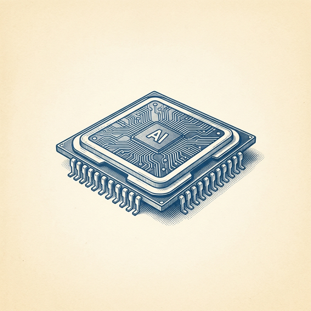
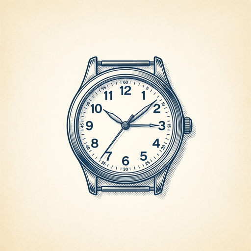
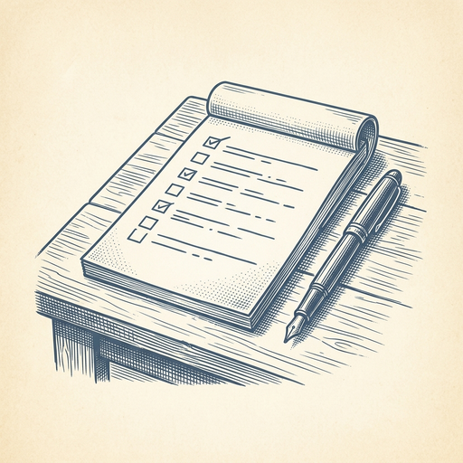

# ai espresso ☕ — Edition 134 · Variant C (Newspaper Comic · Snackable)

*your morning cup of AI*
**WED · NOV 18 · 2026**

---


**NEWS**

## OpenAI ships two new models that do more work for less money

GPT-6.2 Astra is built for complex professional work—writing slides, code, and documents that follow your templates closely. GPT-6.2 Sol handles everyday tasks and multistep workflows. Both models score higher on professional benchmarks while using fewer tokens, so you hit usage limits less often. API pricing for Astra dropped 20%, with 60% off cached inputs.

*You can now run more complex workflows on the same budget and hit rate limits less.*

[OpenAI News](https://openai.com/index/introducing-gpt-6-2-astra-sol) · Nov 18

---


**NEWS**

## AI found a Java bug that can break into banks and hospitals

OpenAI's unreleased GPT-6 Cyber model helped researchers find a memory flaw in Java triggered by feeding its decoder 64 'A' characters plus an equals sign. The bug can let attackers gain full system access on platforms used by 90% of Fortune 500 companies, banks, hospitals, and government agencies. Oracle patched it Tuesday, but unpatched systems could stay vulnerable for years.

*AI is now finding exploits in code that powers critical infrastructure worldwide.*

[Engadget — AI](https://www.engadget.com/2320797/ai-found-a-hole-in-java-and-it-starts-with-aaaaaaaa/) · Nov 18

---



**NEWS**

## Nvidia stops selling H200 chips to China after CEO resignation

Nvidia's interim CEO announced the company will no longer ship its advanced H200 AI chips to China, despite having White House approval to do so. The reversal comes days after former CEO Jensen Huang resigned following reports of an affair with a suspected Chinese intelligence operative, and after 600,000 chips sat stuck in Hong Kong awaiting Beijing's import approval.

*The world's leading AI chip maker just walked away from its second-largest market.*

[The Verge — AI](https://www.theverge.com/tech/1036445/nvidia-h200-ai-chips-china-stop-selling) · Nov 18

---


**NEWS**

## SpaceX just replaced five accounting jobs with Grok Bots

SpaceX's shared services division gave five Grok Bots full ownership of accounting processes—provisioning customer accounts, generating invoices, applying payments, handling collections. Each bot runs its process end-to-end and only escalates to a human when it needs judgment. They work 24/7 and handle more volume than the people who used to do these jobs.

*Real companies are now assigning entire business processes to AI agents, not just tasks.*

[xAI Blog](https://x.ai/news/grok-bot-accounting) · Nov 18

---



**NEWS**

## Apple Watch can now rewind and transcribe your last 15 seconds of conversation

The new Live Rewind feature lets you double-tap your Apple Watch crown to get a transcript of what someone just said. A companion feature, Siri Recap, can listen all day and summarize your conversations by evening. Privacy advocates say it normalizes recording people without consent—the same concern raised by smart glasses.

*Wearables that silently record everyone around you are moving from sci-fi to your wrist.*

[Wired — AI](https://www.wired.com/story/apple-watch-audio-intelligence-live-rewind-siri-recap/) · Nov 18

---


---



**☕ Try this prompt**

### The decision audit trail

*When you're spiraling over a past choice instead of evaluating it cleanly.*


```
I made a big decision three months ago and now I'm second-guessing it. I'll describe what I chose and why. Don't tell me if it was right or wrong. Instead: show me what evidence would prove I should reverse it, what evidence would prove I should double down, and which evidence I'm probably ignoring right now.
```

---

*brewed by ai espresso · [spot something off?](mailto:jhimel@solvd.com?subject=AI%20Espresso%20issue%20report) · [repo](https://github.com/jackiehimel/AI-espresso-agent)*
