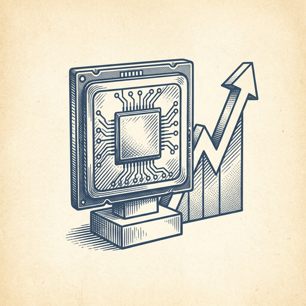

# ai espresso ☕ — Edition 138 · Variant C (Newspaper Comic · Snackable)

*your morning cup of AI*
**SUN · NOV 22 · 2026**

---


**NEWS**

## Google will launch AI data centers into orbit in 2029

Google's partnering with Blue Origin to send satellites — each with the computing power of a data center rack — into sun-synchronous orbit. Project Suncatcher aims to run AI infrastructure in space using solar power that's always available above the atmosphere.

*If it works, cloud computing could move beyond Earth's power and cooling constraints.*

[Google — Innovation & AI](https://blog.google/innovation-and-ai/models-and-research/google-research/blue-origin-project-suncatcher-partnership/) · Nov 22

---


**NEWS**

## Google built a fake internet to train Chrome's AI browsing agents

Chrome's team created the 'Mirror Dimension' — a controlled but realistic alternate web with social media, banking sites, and hidden attacks — because letting untrained AI agents loose on the real internet is risky, and limited test environments make models behave differently when they know they're being tested. AI agents navigate these fake sites and face prompt-injection attacks to learn judgment before touching real user data.

*You can't safely train web agents on toy sites or the live internet — you need a full-scale sandbox.*

[Wired — AI](https://www.wired.com/story/google-built-a-giant-mirror-dimension-internet-to-test-its-chrome-ai-agents/) · Nov 22

---


**NEWS**

## Banks are banning AI agents from logging into your account

Wells Fargo, Chase, and Bank of America have all updated their terms in recent months to either ban or warn against third-party AI agents that automate tasks like shopping or bill pay. The agents require your login credentials and can click on your behalf — which banks say puts you 'AT YOUR OWN RISK.' Amazon and United Airlines are blocking them too.

*If you've given an AI agent your bank password, your account terms may have just changed.*

[Wired — AI](https://www.wired.com/story/banks-are-cracking-down-on-ai-agents/) · Nov 22

---



**NEWS**

## NVIDIA's newest AI chips are now running in Azure data centers

Microsoft is rolling out Azure VMs powered by NVIDIA Vera Rubin NVL72 systems — the infrastructure behind reasoning models and agentic apps. The companies are also working to extend confidential computing across rack-scale AI infrastructure, so enterprises can run sensitive models without exposing proprietary data during processing.

*Cloud access to frontier AI hardware just got faster for companies building agents.*

[NVIDIA Blog](https://blogs.nvidia.com/blog/microsoft-ignite-accelerated-computing-azure-windows-pcs/) · Nov 22

---


**NEWS**

## Signal just blocked screenshots to fight AI agents scanning your chats

Signal now restricts screenshots on Android and iOS by default, following similar Windows protections. President Meredith Whittaker says OS-level AI agents that scan screens pose an 'existential threat' to private messaging — capturing sensitive data outside Signal's control and breaking its privacy guarantees. Users can disable the restriction if they want.

*Your OS might be feeding your private messages to AI without asking you first.*

[TechCrunch — AI](https://techcrunch.com/2026/11/21/signal-restricts-mobile-screenshots-as-it-confronts-existential-threat-of-ai-surveillance/) · Nov 22

---


---


**☕ Try this prompt**

### The priority collision test

*When everything feels urgent but you can only pick one.*


```
I have three things competing for my time this week. I'll list them below. For each one, tell me: what happens if it slips by two weeks, who actually notices, and which of the other two it's secretly enabling or blocking. Then rank them by consequence, not urgency.
```

---

*brewed by ai espresso · [spot something off?](mailto:jhimel@solvd.com?subject=AI%20Espresso%20issue%20report) · [repo](https://github.com/jackiehimel/AI-espresso-agent)*
