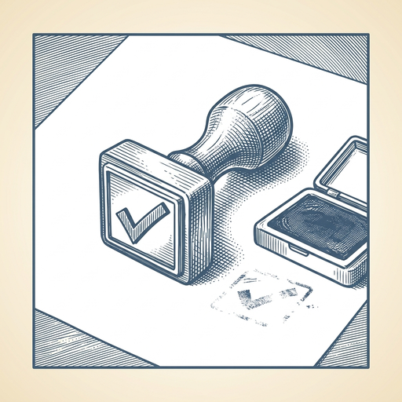
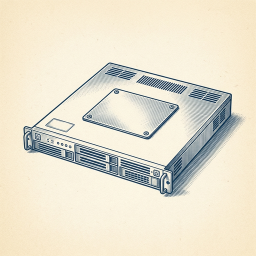
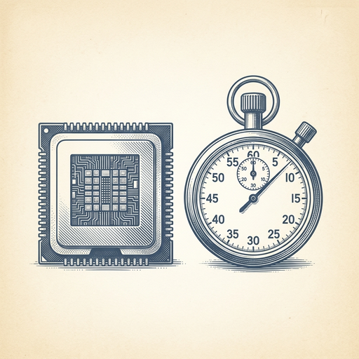

# ai espresso ☕ — Edition 139 · Variant C (Newspaper Comic · Snackable)

*your morning cup of AI*
**MON · NOV 23 · 2026**

---


**NEWS**

## Nvidia reinstates Jensen Huang as CEO after government pressure

Nvidia's board brought back Jensen Huang as CEO in what Bloomberg calls one of the most startling corporate comebacks in history. The reversal followed pressure from the Trump administration. The stock posted its biggest rally in decades on the news.

*Political intervention in corporate leadership decisions is now shaping the AI industry's power structure.*

[Bloomberg Technology](https://www.bloomberg.com/news/articles/2026-11-23/nvidia-reinstates-jensen-huang-as-ceo-with-government-input) · Nov 23

---



**NEWS**

## Claude can now review your pull requests and ship fixes itself

Anthropic's new Claude Ship lets the AI review PRs, fix failing CI checks, resolve merge conflicts, and even approve routine changes if your team allows it. Two new agents handle the work: PR Steward jumps in when tests fail or conflicts arise, while Claude Approvals can greenlight standard changes based on your policies.

*AI agents are now doing the grunt work of code review and deployment, not just writing code.*

[The Verge — AI](https://www.theverge.com/ai-artificial-intelligence/1040134/anthropic-claude-ship-ai-pull-requests) · Nov 23

---



**NEWS**

## OpenAI and Cisco built a tool that patches Linux security holes without restarting

Shirudo is an open-source runtime that lets security teams block exploits on running Linux systems while they roll out permanent fixes. In a test, a Codex-generated shield stopped a Java4Shell attack on Elasticsearch without taking the service offline. It uses eBPF to observe suspicious activity and apply targeted protections without waiting days or weeks for patches.

*Teams can now protect critical systems from zero-day exploits without downtime or waiting for patches.*

[OpenAI News](https://openai.com/index/introducing-shirudo) · Nov 23

---


**NEWS**

## Google Search can now read your credit card bills and Drive files

Google's adding Wallet and Drive to Personal Intelligence in AI Mode. Opt in and Search will answer questions using your spending history, documents, and chat logs—like surfacing which card gives you the best rewards or pulling info from scattered project files. You control which apps connect in Search settings.

*Search stops being a generic oracle and becomes a personal assistant that knows your actual context.*

[Google AI Blog](https://blog.google/products-and-platforms/products/search/google-search-personal-intelligence-apps/) · Nov 23

---



**NEWS**

## Amazon acquires Decart's chip optimization stack to speed up AI inference

Amazon is buying Decart's optimization technology and hiring its founding team to make its Trainium chips run AI models faster and cheaper. Decart built a full-stack approach that optimizes both hardware and software together, which Amazon has been testing since 2025 on everything from language models to agentic systems.

*Faster, cheaper inference means more companies can actually afford to run AI at scale.*

[Amazon News (About Amazon)](https://www.aboutamazon.com/news/company-news/amazon-decart-ai-optimization?utm_source=rss) · Nov 23

---


---


**☕ Try this prompt**

### The assumption inventory

*Before you buy the textbook or book the course.*


```
I'm about to start learning something new and I'll describe it below. List the three assumptions I'm probably making about how hard it will be, how long it takes, or what I need to know first. Then tell me which assumption to test in the next hour.
```

---

*brewed by ai espresso · [spot something off?](mailto:jhimel@solvd.com?subject=AI%20Espresso%20issue%20report) · [repo](https://github.com/jackiehimel/AI-espresso-agent)*
