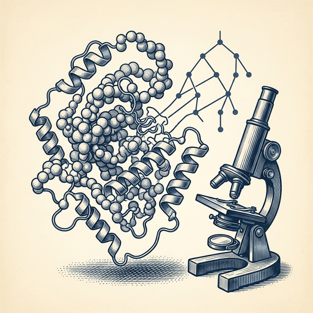
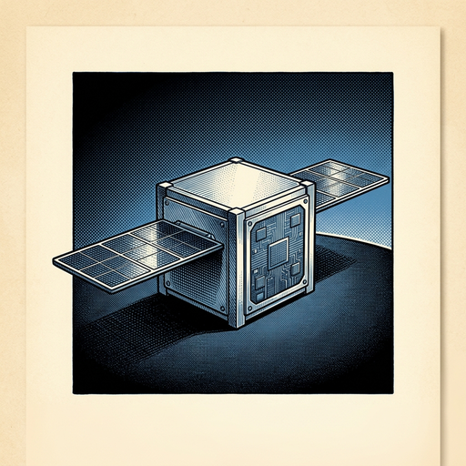

# ai espresso ☕ — Edition 141 · Variant C (Newspaper Comic · Snackable)

*your morning cup of AI*
**WED · NOV 25 · 2026**

---



**NEWS**

## OpenAI's GPT-6 can now design proteins from scratch using just reasoning and code

GPT-6 designs new protein structures and amino acid sequences without calling specialized biology models—it reasons through the math, physics, and chemistry, then writes code to generate designs. Lab tests with partner Onava showed five proteins based on GPT-6.2 designs binding to their targets. The model can also take prompts like "attach here" or "fold this shape."

*General AI models are replacing specialized scientific tools in molecular design.*

[OpenAI News](https://openai.com/index/gpt-6-models-demonstrate-intrinsic-protein-design-capabilities) · Nov 25

---



**NEWS**

## SpaceX can now launch up to 1 million AI satellites into orbit

The FCC just approved SpaceX's 'Starmind' constellation — satellites with AI chips that beam compute back to Earth via laser. SpaceX must launch one by 2033 and hit 1 million by 2040. Google and Blue Origin are racing similar projects.

*Data centers are moving to space where solar power is constant and cooling is free*

[The Verge — AI](https://www.theverge.com/science/1042278/spacex-fcc-starmind-ai-space-data-centers) · Nov 25

---


**NEWS**

## OpenAI researchers just disproved a 70-year-old math conjecture

OpenAI published a proof showing the polynomial Hirsch conjecture is false. The conjecture claimed you could navigate between vertices of certain geometric shapes in polynomial time—a question tied to how efficiently optimization algorithms work. The team posted the paper on GitHub, marking a rare pure-math contribution from an AI lab.

*Major optimization algorithms rely on assumptions this conjecture supported—now those need rethinking.*

[Hacker News (front page)](https://github.com/openai/math/blob/main/preprints/Superpolynomial-graph-diameter-of-simple-polytopes-November-24-2026/paper.pdf) · Nov 25

---


**NEWS**

## Google releases 10 papers on integer factoring and game theory — from an AI named Cogentic

Google just dropped a folder of research papers authored by something called Cogentic, covering decades-old computer science problems like integer factorization, discrete logarithms, and Nash equilibria. The factorization paper claims a faster-than-expected algorithm, and several others tackle problems in computational game theory and learning theory.

*If the factorization results hold, they could affect cryptography assumptions used across the internet.*

[Hacker News (front page)](https://github.com/google-research/google-research/tree/master/cogentic_research_papers) · Nov 25

---


**NEWS**

## ElevenLabs is raising money at a $33 billion valuation

The AI voice company behind hyper-realistic text-to-speech is in early funding talks that would value it at $33 billion. That's more than double its last raise and puts it in the same tier as companies like Anthropic and Databricks.

*Voice AI is becoming infrastructure-grade — investors are betting billions on it.*

[Bloomberg Technology](https://www.bloomberg.com/news/articles/2026-11-25/elevenlabs-in-early-talks-for-2027-funding-at-33-billion-value) · Nov 25

---


---


**☕ Try this prompt**

### The negotiation floor-finder

*Before you counter-offer or sign anything you'll regret.*


```
I'm negotiating something I'll describe below. I need to find my walk-away point. Ask me three questions — one about what happens if I say no, one about what I'm afraid to lose, and one about what I'd tell a friend in my position. Then tell me my actual floor.
```

---

*brewed by ai espresso · [spot something off?](mailto:jhimel@solvd.com?subject=AI%20Espresso%20issue%20report) · [repo](https://github.com/jackiehimel/AI-espresso-agent)*
