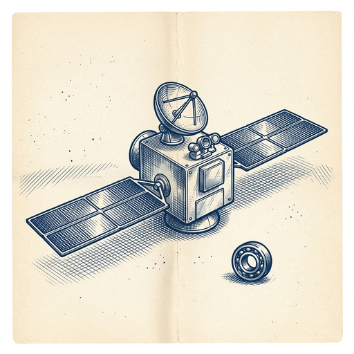
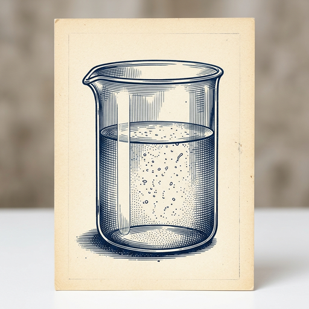

# ai espresso ☕ — Edition 142 · Variant C (Newspaper Comic · Snackable)

*your morning cup of AI*
**THU · NOV 26 · 2026**

---


**NEWS**

## An AI just proved math's most famous problem in 17 million lines of code

Anthropic researcher Levent Alpöge used Claude to generate a proof of the 167-year-old Riemann hypothesis in the Lean programming language. The code compiles and appears sound, but the proof is so long and counterintuitive that hundreds of mathematicians are now racing to decode it into something humans can actually understand and build on.

*A machine-checkable proof exists, but nobody knows yet what new math it contains or how it works.*

[Wired — AI](https://www.wired.com/story/ai-solved-maths-most-famous-problem/) · Nov 26

---



**NEWS**

## SpaceX can now launch 1 million satellites to run AI in orbit

The FCC approved SpaceX's Starmind plan to deploy satellites running AI compute in space by 2040. The company argues orbital data centers use solar power and skip ground facilities' energy and water costs. Critics say space's vacuum traps heat with 'basic physical limits' on radiation cooling, and a million satellites risk collisions and massive space junk.

*If it works, AI computing moves off-planet. If it doesn't, we get orbital debris at unprecedented scale.*

[Engadget — AI](https://www.engadget.com/2329071/spacex-gets-fcc-approval-to-deploy-1-million-satellites-for-its-ai-orbital-data-center/) · Nov 26

---



**NEWS**

## DeepMind built an AI that identifies unknown molecules from mass spec data

Mass Spec Skills translates tandem mass spectrometry readings into molecular structures, helping scientists identify compounds in blood, soil, or plant samples that don't match any reference library. It runs inside Google Antigravity and matches frontier-level accuracy even with a lightweight model, potentially solving the "dark matter" problem where 90-95% of detected signals go unidentified.

*Could unlock the vast majority of molecules scientists detect but can't currently identify*

[Google DeepMind Blog](https://deepmind.google/blog/interpreting-mass-spectra-with-google-antigravity/) · Nov 26

---


**NEWS**

## Two amateur astronomers used ChatGPT to find new planets in old telescope data

An OpenAI engineer and a startup founder independently used Codex and Astra to comb through millions of star observations from NASA's Kepler telescope. Both found candidate exoplanets that professional astronomers had missed—signals now worth a closer look with more powerful instruments.

*AI tools are letting anyone with curiosity search datasets that used to require specialized training.*

[OpenAI News](https://openai.com/index/searching-for-distant-planets-with-astra) · Nov 26

---


**NEWS**

## Nvidia pauses chip shipments to Southeast Asia after US closes remote-access loophole

Nvidia told partners to halt GPU shipments to the region after Washington closed a loophole that let Chinese companies remotely access AI computing power housed in Southeast Asian data centers. The move targets cloud providers who were essentially renting US chips to Chinese customers.

*US export controls are now reaching beyond physical borders to block remote AI compute access.*

[WSJ — Tech](https://www.wsj.com/tech/nvidia-tells-partners-to-pause-shipments-to-southeast-asia-5b791cb0?mod=rss_Technology) · Nov 26

---


---


**☕ Try this prompt**

### The research rabbit hole escape

*When you've got 47 tabs open and forgot what you were originally looking for.*


```
I'm researching a topic and I've collected way too much information. I'll dump my notes and links below. Give me: the one insight that actually changes how I should think about this, two things I can safely ignore, and the single follow-up question worth chasing.
```

---

*brewed by ai espresso · [spot something off?](mailto:jhimel@solvd.com?subject=AI%20Espresso%20issue%20report) · [repo](https://github.com/jackiehimel/AI-espresso-agent)*
