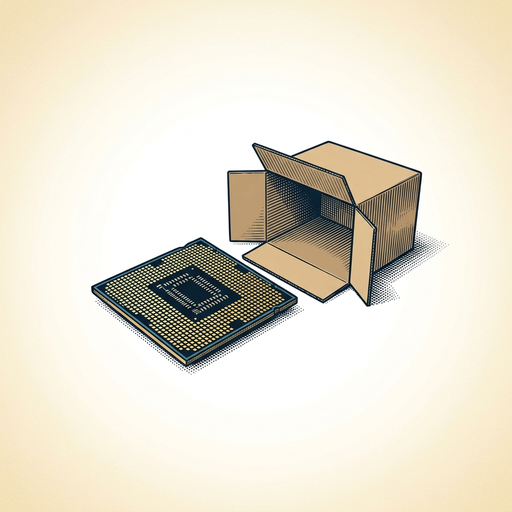

# ai espresso ☕ — Edition 143 · Variant C (Newspaper Comic · Snackable)

*your morning cup of AI*
**FRI · NOV 27 · 2026**

---


**NEWS**

## OpenAI countersues Apple for allegedly blocking its hardware suppliers

OpenAI claims Apple is threatening suppliers who work with the ChatGPT maker and encouraged employees to store corporate files on personal devices. The countersuit escalates a legal fight Apple started in July, when it accused OpenAI of stealing iPhone and Apple Watch design secrets through former Apple employees now working on OpenAI's consumer hardware plans.

*Two of tech's biggest players are now accusing each other of industrial espionage over AI hardware.*

[9to5Mac — AI](https://9to5mac.com/2026/11/27/openai-countersues-apple-alleging-trade-secret-theft-and-supplier-threats/) · Nov 27

---


**NEWS**

## Nvidia's CEO apologizes to employees, says he's in therapy

Jensen Huang returned to Nvidia and told employees he violated the company's code of conduct and 'made some terrible mistakes.' He acknowledged entering therapy. The specific violations weren't detailed in public statements.

*The face of the AI chip industry just admitted serious misconduct at the company powering most AI development.*

[NYT — Technology](https://www.nytimes.com/2026/11/24/technology/jensen-huang-apology-nvidia-ceo.html) · Nov 27

---


**NEWS**

## OpenAI is merging ChatGPT and Work — heavy users will hit limits faster

OpenAI started rolling out a unified ChatGPT experience that shares one usage meter across chat and work tasks. The company admits its heaviest users will hit rate limits sooner than before, even while paying the same subscription price. The basic 'Instant' model stays unlimited.

*If you're a power user, you'll get less access to advanced models for the same money.*

[TechCrunch — AI](https://techcrunch.com/2026/11/25/openai-says-heavy-chatgpt-users-may-hit-limits-sooner-as-it-merges-chat-and-work/) · Nov 27

---



**NEWS**

## Nvidia stops shipping AI chips to Southeast Asia

Nvidia told Dell and Super Micro to halt server shipments to Malaysia, Singapore, Thailand, and Indonesia while it checks whether partners meet U.S. export rules. Chinese companies have been accessing Nvidia chips remotely through data centers in those countries — a loophole the Commerce Department closed earlier this month.

*About a quarter of China's AI computing power comes from these remote data centers.*

[TechCrunch — AI](https://techcrunch.com/2026/11/26/nvidia-hits-pause-on-chip-shipments-to-southeast-asia/) · Nov 27

---


**NEWS**

## 42 state AGs move to block Character.AI from selling user chats in bankruptcy

A bipartisan coalition says Character.AI plans to auction off chat histories from 21 million US accounts—including 2.1 million minors—with no privacy protections or deletion options. The first bidder was incorporated just days before the auction, with no listed parent company or investors.

*Your AI chat logs could become an asset sold to the highest bidder when companies go bankrupt.*

[The Verge — AI](https://www.theverge.com/policy/1042620/character-ai-sale-state-ags-block-selling-users-chats) · Nov 27

---


---


**☕ Try this prompt**

### The hiring red-flag translator

*For when your gut speaks but your debrief doc stays blank.*


```
I just interviewed a candidate and something felt off, but I can't articulate it yet. I'll describe what they said and how they said it below. Tell me: the specific behavior I'm reacting to, whether it predicts actual job performance, and the one follow-up question that would confirm or kill my concern.
```

---

*brewed by ai espresso · [spot something off?](mailto:jhimel@solvd.com?subject=AI%20Espresso%20issue%20report) · [repo](https://github.com/jackiehimel/AI-espresso-agent)*
